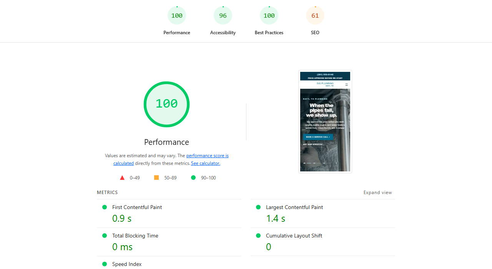
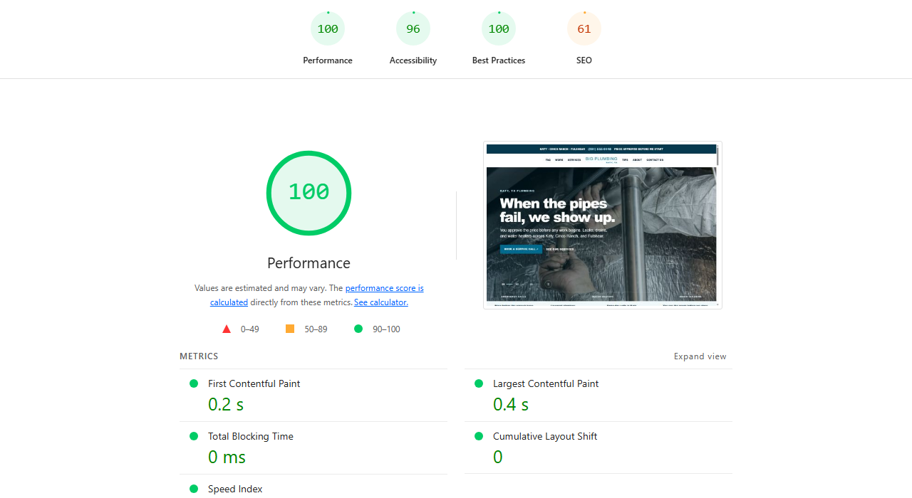

# Hosted WordPress performance check

**Captured November 1, 2026 at 7:36 AM CDT.** Big Plumbing WordPress 0.1.0 was measured on a hosted WordPress test installation. The internal test address is omitted from this public record. Uncropped screenshots and complete Lighthouse HTML and JSON reports are retained in the private theme repository.

| Lighthouse profile | Performance | Accessibility | Best Practices | SEO | FCP | LCP | TBT | CLS |
| --- | ---: | ---: | ---: | ---: | ---: | ---: | ---: | ---: |
| Mobile | 100 | 96 | 100 | 61 | 0.9 s | 1.4 s | 0 ms | 0 |
| Desktop | 100 | 96 | 100 | 61 | 0.2 s | 0.4 s | 0 ms | 0 |

The reports used Lighthouse 12.8.2 and Headless Chromium 156. Mobile used an emulated Moto G Power with simulated Slow 4G. These are anonymous initial page-load lab runs.

The test site includes `noindex, nofollow`, and the homepage has no meta description. Those two SEO audits account for the 61 score. The indexing block should be removed when a production site is ready for search. Lab scores do not represent field Core Web Vitals, concurrency, or uptime.
